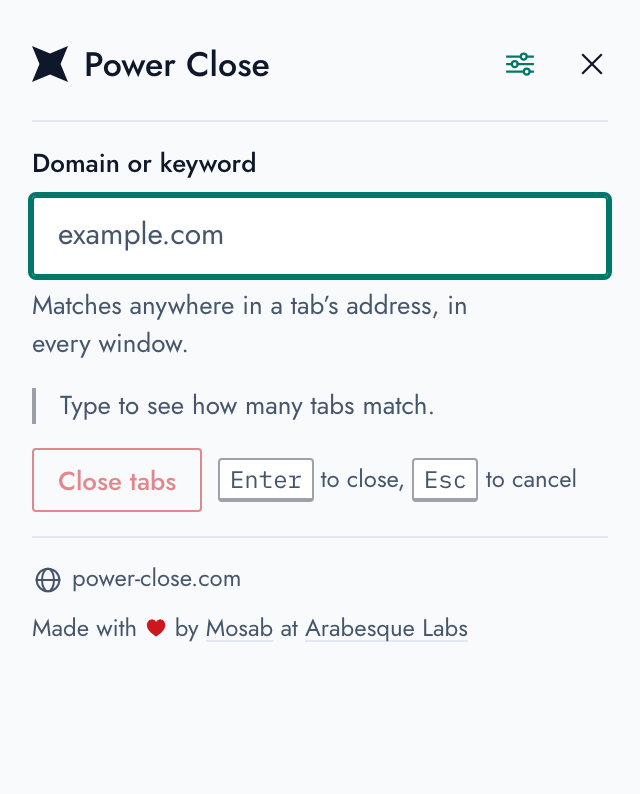
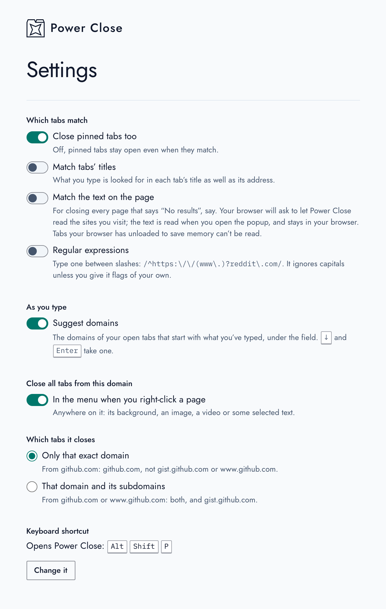

# Power Close

A browser extension, for the tab addict, that closes every tab whose address
contains a keyword or a domain name. Many Facebook tabs open, scattered across
windows? Type `facebook.com`, press Enter, and they're all closed.

## How it looks in action

<picture>
  <source media="(prefers-color-scheme: dark)" srcset="website/screenshots/demo-dark.gif">
  
</picture>

## Install

- [Chrome Web Store](https://chrome.google.com/webstore/detail/power-close/jjpmcpmmajigbkjchbkoclipomlmpaaj)
- [Firefox Add-ons](https://addons.mozilla.org/firefox/addon/firefox-power-close/)

It runs on Chrome (Manifest V3), Firefox 140 and later, and Firefox for Android
142 and later.

## Usage

Press the Power Close button in the toolbar and type a keyword or domain name.
As you type, the popup counts the tabs that match, so you can see what will
close before anything does. Press <kbd>Enter</kbd>, or the button that names
the count, to close them; <kbd>Esc</kbd> closes the popup and leaves your tabs
alone.

<kbd>Alt</kbd>+<kbd>Shift</kbd>+<kbd>P</kbd> opens the popup from the keyboard
(change it in your browser's extension shortcuts). As you type, the domains of
your open tabs that start with what you've typed are suggested under the
field: <kbd>↓</kbd> and <kbd>Enter</kbd> take one.

You can also right-click a page, anywhere on it (an image or selected text
too), and choose **Close all tabs from this domain**. It can be on the tab's
own menu as well, in Firefox and recent versions of Chrome.

### What matches

- **The popup** matches what you type anywhere in a tab's full address,
ignoring case, across every window. So `github.com` also closes
`gist.github.com`, and a search results page whose address contains
"github.com". Domains and addresses in other scripts match as you'd read them:
`مثال.مصر` finds the tabs on that domain.

- **The right-click option** matches the page's exact hostname, so it closes
that site's tabs only: not its subdomains, and `www.github.com` and
`github.com` count as different sites. A setting widens it to the site's
subdomains.

### Settings

Open them from the popup's settings button, or from your browser's extensions
page. Each applies as soon as you change it, and they sync with your browser.

| Setting | Default |
|---|---|
| Close pinned tabs too | On |
| Match tabs' titles | Off |
| Match the text on the page (asks your browser for access to read pages) | Off |
| Regular expressions, typed as `/pattern/` | Off |
| Suggest domains as you type | On |
| Right-click option on pages | On |
| Right-click option on tabs (where the browser has a tab menu) | Off |
| Which tabs the right-click option closes: the exact domain, or its subdomains too | Exact |



Closed too many? Your browser's Reopen Closed Tab
(<kbd>Ctrl</kbd>/<kbd>⌘</kbd>+<kbd>Shift</kbd>+<kbd>T</kbd>) brings them back.

## Privacy

Power Close reads your tabs' addresses (and titles) to match and close them,
and nothing else. If you turn on matching the text on the page, it asks your
browser for access to read pages, reads them only when you open the popup, and
keeps what it reads in the popup until it closes; turn the setting off and the
access is given back. It has NO network code, collects NO data, and needs NO
account.

## Development

You'll need `make` and `zip`.

```
make            # build both: dist/chrome/ and dist/firefox/
make chrome     # build Chrome only
make firefox    # build Firefox only
make validate   # check the manifests are valid JSON
```

Each folder in `dist/` holds the unpacked extension and a `power-close.zip` of
it for the stores.

To try a build:

- **Chrome:** open `chrome://extensions`, turn on Developer mode, choose **Load
unpacked** and pick `dist/chrome/`.

- **Firefox:** open `about:debugging#/runtime/this-firefox`, choose **Load
Temporary Add-on…** and pick `dist/firefox/manifest.json`.

The source is in `src/`: the popup in `src/popup/`, the settings page in
`src/options/`, the right-click option in `src/background.js`, and what they
share (the settings and the matching rules) in `src/lib/`, as ES modules. The
two browsers share everything except their manifests
(`src/manifest-chrome.json` and `src/manifest-firefox.json`), so change both
when you change one.

`make screenshots` retakes the popup's screenshots, the GIF above and the
settings page's screenshot, and makes the stores' screenshots: five at
1280x800 for the Chrome Web Store in `dist/screenshots/chrome/`, and the same
five at 2400x1800 for addons.mozilla.org in `dist/screenshots/firefox/` (it
needs Node 22+, Chrome and ffmpeg).

## Design

The popup is built on the [Arabesque Labs design
system](https://design.arabesquelabs.com/), vendored into
`src/vendor/arabesque/`.

## Credits

- [Mosab Ibrahim](https://mosab.co.uk) wrote Power Close for Firefox in 2014
- [Mina Asham](https://github.com/mina-asham) ported it to Chrome
- and it's now maintained by [Mosab Ibrahim](https://mosab.co.uk) at [Arabesque Labs](https://arabesquelabs.com/)

Bug reports and contributions are welcome in [the
issues](https://github.com/ArabesqueLabs/power-close/issues).

## License

Copyright © 2014–2026 Mosab Ibrahim. Free software under the GNU General Public
License, version 2 or (at your option) any later version: see
[LICENSE](LICENSE).
